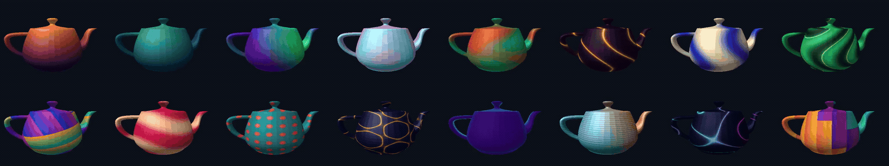

# shady

A small compiler for a subset of GLSL. It takes a fragment shader, emits SPIR-V,
and runs the result through Vulkan.

I got curious about compiler theory after reading the Dragon Book. I wanted to
build something where I could follow the whole path from source code to a result
on my GPU. Shaders seemed like a good way to do that.

[](docs/videos/teapots-2x8.mp4)

Sixteen surface shaders, from simple spectrum and sunset gradients to layered
iridescent flows, compiled by Shady and rendered with Vulkan on an RTX 3060.
The camera makes a seamless eight-second spherical orbit. Patterns stay attached
to the mesh and are lit using its normals through the existing shader inputs.

[Watch the MP4](docs/videos/teapots-2x8.mp4) ·
[View the autoplay grid on my website](https://kennykguo.com/rollouts/) ·
[Read the shader sources](examples/turntable/)

The fragment shaders go through Shady → `spirv-as` → `spirv-val`. The small orbit
vertex shader is compiled with glslang. No compiler changes were needed.

## How it works

The scanner turns the source into tokens. The parser builds an abstract syntax
tree, and the semantic checker walks that tree to resolve names and check types.
The code generator then emits SPIR-V assembly.

`spirv-as` turns that text into a binary. `spirv-val` checks it against Vulkan's
rules. A small offscreen renderer loads the binary as a fragment shader and draws
a teapot. The GPU driver handles the final translation to hardware instructions.

One interesting part is `if/else`. The code generator lowers assignments in each
arm to `OpSelect` operations. It evaluates expressions and uses a predicate to
choose which values get stored. Nested conditions combine predicates with
`OpLogicalAnd`.


That diagram is a simplified view of
[`14_threshold_half.frag`](tests/shaders/14_threshold_half.frag). Each assignment
to a vector component produces its own select. There is no branch instruction in
the generated code for these examples.

## Build and try it

The compiler needs a C compiler, GNU Make 4.3 or newer, Flex, and Bison.
The validation tools come from SPIRV-Tools. Rendering also needs a C++17 compiler,
Vulkan headers and loader, a working Vulkan driver, and `glslangValidator`.

```sh
make
./build/shady tests/shaders/15_gradient_rgb.frag -o build/gradient.spvasm
spirv-as --target-env vulkan1.0 build/gradient.spvasm -o build/gradient.spv
spirv-val --target-env vulkan1.0 build/gradient.spv

make build/render build/mesh.vert.spv
./build/render build/gradient.spv tests/assets/teapot.obj build/gradient.png
```

Run the renderer from the repository root. It reads `build/mesh.vert.spv` and
writes an 800 × 600 PNG; it doesn't open a window. It uses the first Vulkan device
and prints its name.

The compiler also reads stdin, and `--ast` prints the checked syntax tree instead
of emitting SPIR-V:

```sh
./build/shady < tests/shaders/15_gradient_rgb.frag > build/gradient.spvasm
./build/shady --ast tests/shaders/15_gradient_rgb.frag
```

## The language is small

A shader is a block, without a `main` declaration or a GLSL version directive:

```glsl
{
    float x = gl_FragCoord[0] / 800.0;
    float y = gl_FragCoord[1] / 600.0;
    gl_FragColor = vec4(x, y, 1.0 - x, 1.0);
}
```

The examples cover float arithmetic, float vector constructors and indexing,
comparisons, and nested conditionals. `gl_FragCoord`, `gl_Color`, and `gl_TexCoord`
are inputs; `gl_FragColor` is the output.
`sin`, `cos`, `fract`, and `abs` accept one float scalar and return a float.
Vector arguments and implicit integer conversions are unsupported for these functions.

This isn't full GLSL. There are no loops, textures, user-defined functions, or
vertex/compute shader compilation. The parser recognizes more types than the
backend fully supports, including integer and boolean declarations. Float-based
examples in the test suite are the supported path. Legacy OpenGL uniform inputs
have been removed rather than pretending they work with the Vulkan renderer.

## Check the output

```sh
make test          # compile and validate every shader; reject invalid programs
make render-test   # also compare the renders against glslang
make comparison    # render the suite and build the gallery for new shaders 21–40
make images        # rebuild the diagrams and shader montage
```

`render-test` compiles each shader twice: once with Shady, once with glslang. Both
binaries go through the same Vulkan renderer and mesh. The test fails if any RGB
channel differs by more than 1 out of 255. The image comparison and montage use
Python's Pillow package. Diagram rendering uses `rsvg-convert`.

Shaders **21–40** add checker/weave patterns, implicit curves, nested mosaics,
vector arithmetic, color input, and inverse-square-root normalization. After
`make comparison`, open `build/comparison/index.html` for all 20 Shady/reference
pairs, amplified difference images, source, and links to both SPIR-V binaries
and assembly. Full renders are in `build/tests/`; `comparison.json` records the
device, tool versions, source hashes, and RGB errors. The reference adapter adds
a GLSL 450 interface and renames `rsq` to `inversesqrt`; Shady's fragment output
is assembled directly and never compiled by glslang.

Four paired contact sheets are saved to `docs/images/comparison-{1,2,3,4}.png`.
See [the cleanup review](docs/REVAMP_REVIEW.md) for the earlier changes and
remaining compiler issues confirmed during this comparison.

All build products go into `build/`. `make clean` removes that directory.
`make format` applies the checked-in clang-format style to the C and C++ source;
`make format-check` checks it without changing files.

## Where to read the code

| File | What happens there |
| --- | --- |
| [`src/scanner.l`](src/scanner.l) | Token rules and literal parsing |
| [`src/parser.y`](src/parser.y) | Grammar and AST construction |
| [`src/ast.h`](src/ast.h), [`src/ast.c`](src/ast.c) | Node definitions, printing, and cleanup |
| [`src/semantic.c`](src/semantic.c), [`src/symbol.c`](src/symbol.c) | Type checking and scoped symbol tables |
| [`src/codegen.c`](src/codegen.c) | SPIR-V types, constants, expressions, and predication |
| [`src/main.c`](src/main.c) | The compiler entry point |
| [`tools/render.cpp`](tools/render.cpp) | Vulkan setup, mesh loading, and PNG output |
| [`tools/verify.py`](tools/verify.py) | Validation and reference-render comparisons |

The stage graph and predication diagram are editable SVGs. Their generator and
the montage layout are in [`tools/visuals.py`](tools/visuals.py).

## Reading

*Compilers: Principles, Techniques, and Tools*,
by Aho, Lam, Sethi, and Ullman, was the starting point. The scanner → parser →
semantic analysis → code generation structure here follows that approach.

The renderer uses [`stb_image_write.h`](tests/vendor/stb_image_write.h) for PNG
output. Its license is included in the header.

For larger shader-only experiments, see [the stress examples](tests/stress/README.md):
unrolled fractals, Voronoi materials, nested inlays, and a 256-step ray marcher.
Their generator and comparison runner leave the compiler unchanged.

For the broader visual survey, see [100 capability shaders](tests/capabilities/README.md):
20 algorithm families rendered through both unchanged compiler paths, with a searchable gallery.
